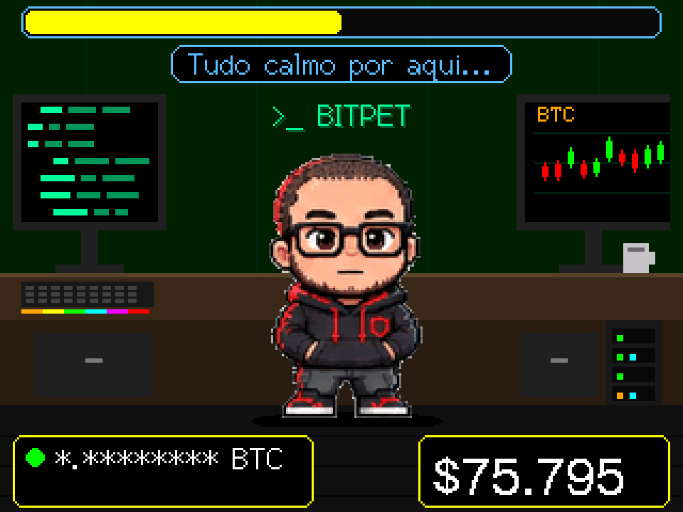
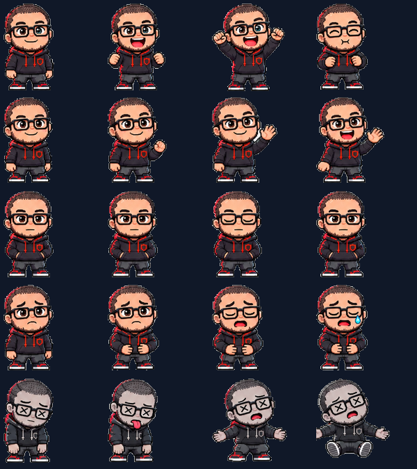
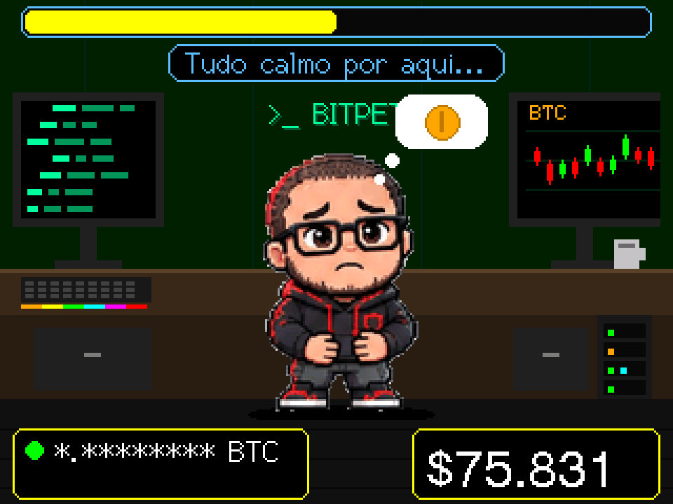
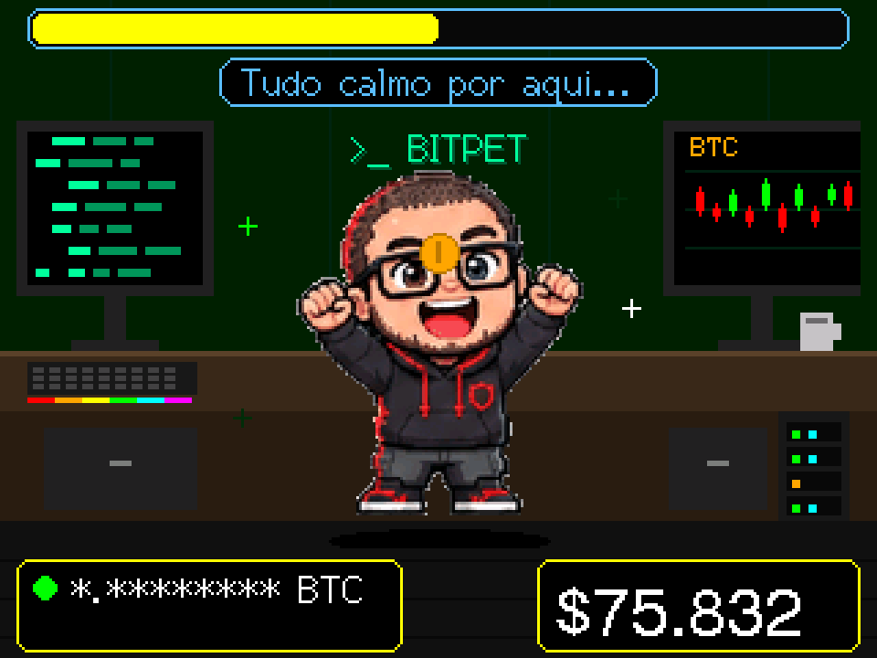
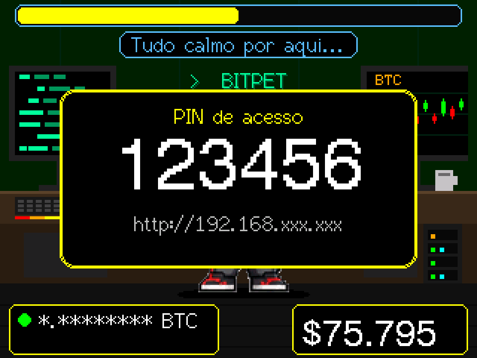
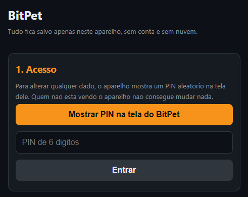
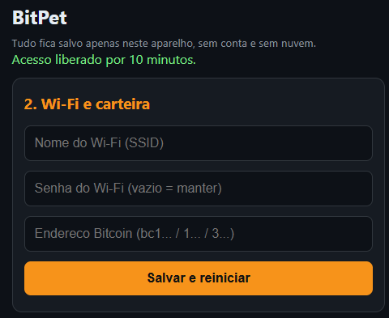
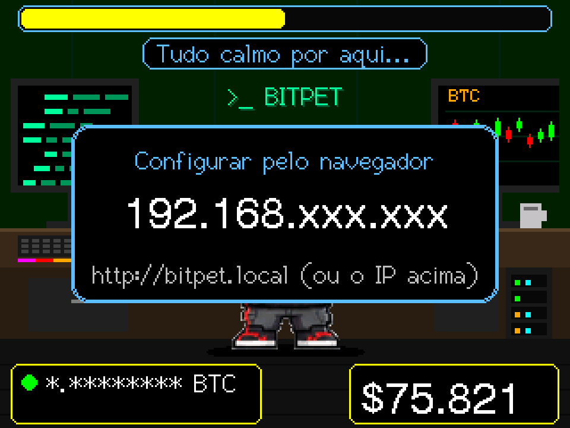
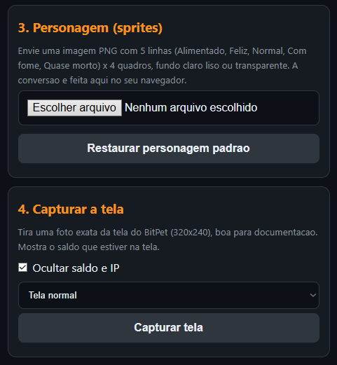

# BitPet

Um mini-pet estilo Tamagotchi que vive numa tela de ESP32 e mostra o **saldo de um endereço Bitcoin** e a **cotação ao vivo do BTC**. O humor dele muda com o mercado: na alta ele se alimenta e fica feliz, na queda ele sente fome e chega a quase morrer.

<p align="center">
  
</p>

## O que ele faz

- Mostra o **saldo em BTC** do endereço que você informar, com o valor aproximado em **USD**.
- Mostra a **cotação BTC/USD** ao vivo e a variação de 24 horas.
- Avisa quando há **transações pendentes** (na mempool) no seu endereço.
- Tem **5 humores animados**, com 4 quadros cada, que seguem a variação do mercado:

| Humor | Quando | Variação 24h |
|---|---|---|
| Alimentado | alta extrema, ele se autoalimenta | ≥ +5% |
| Feliz | mercado animado | ≥ +1,5% |
| Normal | tudo calmo | entre −1,5% e +1,5% |
| Com fome | baixa | até −5% |
| Quase morto | baixa extrema | abaixo de −5% |

- É **interativo** (veja [Toque na tela](#toque-na-tela)).
- Configuração pelo celular em cerca de 1 minuto, protegida por **PIN aleatório** mostrado na tela do aparelho.
- Você pode **trocar o personagem** enviando a sua própria folha de sprites pela página de configuração.

Os 5 humores, com 4 quadros de animação cada:



<p align="center">
  
  
</p>

## Privacidade

- O Wi-Fi e o endereço ficam **somente na memória flash do aparelho**. Não existe conta, cadastro, nuvem do projeto nem rastreio.
- Para funcionar, o aparelho consulta duas APIs públicas por HTTPS:
  - [CoinGecko](https://www.coingecko.com/) para o preço do Bitcoin.
  - [mempool.space](https://mempool.space/) para o saldo. **O endereço que você monitora é enviado a esse serviço**, como em qualquer explorador de blocos. Se isso importa para você, aponte o firmware para uma instância própria do mempool (altere a URL em `fetchData()` no `bitpet.ino`).
- Use **apenas endereços públicos**. O BitPet nunca precisa de chave privada nem de seed. Nunca digite uma seed em nenhum lugar.
- As alterações pela página só são aceitas com um **PIN de 6 dígitos que aparece só na tela do aparelho**. Veja [Segurança da configuração](#segurança-da-configuração) para os limites dessa proteção.

## Hardware

- Placa **ESP32-2432S028**, conhecida como **CYD** (Cheap Yellow Display): ESP32, tela TFT 2,8" 240×320 (ILI9341) e toque resistivo (XPT2046).
- Cabo USB para energia e gravação.
- Opcional: suporte de acrílico.

> Algumas CYD vêm com a tela **ST7789** em vez da ILI9341 (geralmente as que têm duas portas USB). Para elas, o `User_Setup.h` precisa de outro driver e as cores/inversão mudam. Os passos abaixo foram testados com a variante ILI9341.

## Instalação

### Opção A: gravar pelo navegador (sem instalar nada)

Se este repositório estiver publicado com o firmware compilado em `web/firmware/`, abra a página de instalação no **Chrome** ou no **Edge** (precisa de HTTPS, como o GitHub Pages), conecte a CYD por USB e clique em **Instalar**. Para gerar esses arquivos, veja [Publicar o instalador web](#publicar-o-instalador-web).

### Opção B: compilar com o Arduino IDE

#### 1. Instalar o Arduino IDE

Baixe a versão 1.8.x ou 2.x em <https://www.arduino.cc/en/software>. Estas instruções foram testadas no **1.8.19**.

#### 2. Instalar o suporte ao ESP32

1. Vá em **Arquivo → Preferências**.
2. No campo **URLs Adicionais para Gerenciadores de Placas**, cole:
   ```
   https://espressif.github.io/arduino-esp32/package_esp32_index.json
   ```
3. Vá em **Ferramentas → Placa → Gerenciador de Placas**, procure por **esp32** (da *Espressif Systems*) e instale a versão **3.3.x**.

> Se a pasta do Arduino estiver dentro do OneDrive, o download do pacote pode falhar (erro `xtensa-esp32-elf-g++: file does not exist`). Em **Arquivo → Preferências**, mude o **Local do Sketchbook** para uma pasta fora do OneDrive, por exemplo `D:\Arduino\Sketchbook`, e reinstale o pacote esp32.

#### 3. Instalar as bibliotecas

Em **Sketch → Incluir Biblioteca → Gerenciar Bibliotecas**, instale:

| Biblioteca | Autor | Versão testada |
|---|---|---|
| **TFT_eSPI** | Bodmer | 2.5.x |
| **ArduinoJson** | Benoit Blanchon | 7.x |
| **XPT2046_Touchscreen** | Paul Stoffregen | 1.4 |

As demais (`WiFi`, `WebServer`, `DNSServer`, `Preferences`, `HTTPClient`, `LittleFS`, `ESPmDNS`) já vêm no pacote esp32. O aviso "múltiplas bibliotecas encontradas para WiFi.h" é normal e pode ser ignorado.

#### 4. Configurar a TFT_eSPI para a CYD

A TFT_eSPI lê a configuração do `User_Setup.h` que fica **dentro da pasta da biblioteca**. Copie o arquivo [`User_Setup.h`](User_Setup.h) deste repositório para:

```
<Sketchbook>\libraries\TFT_eSPI\User_Setup.h
```

substituindo o original. Se você atualizar a biblioteca depois, repita a cópia, porque a atualização sobrescreve o arquivo.

#### 5. Abrir o projeto e escolher a placa

1. Abra [`bitpet/bitpet.ino`](bitpet/bitpet.ino). Os arquivos `page.h` e `sprites.h` precisam ficar na mesma pasta.
2. Em **Ferramentas**, configure:

| Opção | Valor |
|---|---|
| Placa | **ESP32 Dev Module** (não escolha ESP32C3, S2 ou S3) |
| **Partition Scheme** | **Huge APP (3MB No OTA/1MB SPIFFS)**. É obrigatório, porque o firmware passa de 1,2 MB |
| Upload Speed | 921600 (use 115200 se der erro de gravação) |
| Porta | a COM da CYD |

3. Clique em **Verificar** e depois em **Carregar**.

> Se a gravação não começar, segure o botão **BOOT** da placa quando aparecer "Connecting...", e solte quando começar a gravar.

## Primeira configuração

1. Ao ligar, o BitPet mostra um teste de cores durante 3 segundos (veja [Cores erradas](#problemas-comuns)) e, sem configuração, abre a tela **"Configure no celular"**.
2. No celular, conecte-se ao Wi-Fi **`BitPet-Setup`** (sem senha). A página deve abrir sozinha. Se não abrir, acesse **`http://192.168.4.1`**.
3. Toque em **Mostrar PIN na tela do BitPet**. Um PIN de 6 dígitos aparece na CYD.
4. Digite o PIN e clique em **Entrar**.
5. Informe o **nome do Wi-Fi** (rede de **2,4 GHz**, o ESP32 não usa 5 GHz), a **senha** e o **endereço Bitcoin** (`bc1...`, `1...` ou `3...`).
6. Clique em **Salvar e reiniciar**. O BitPet conecta, mostra o IP dele por 5 segundos e começa a funcionar.

<p align="center">
  
</p>
<p align="center">
  
  
</p>

O PIN e o endereço mostrados nestas imagens são de exemplo.

## Uso diário

### Toque na tela

| Gesto | Onde | O que acontece |
|---|---|---|
| 1 toque | no pet | Ele recebe um **carinho**: fica feliz e solta corações por alguns segundos |
| 2 toques seguidos | no pet | **Prévia** de outra animação, alternando entre os 5 humores |
| 1 toque | na barra do topo | Mostra o **IP** do aparelho por 10 segundos |

### Alterar Wi-Fi, carteira ou personagem depois

1. Toque na **barra do topo** do BitPet para ver o IP, ou use `http://bitpet.local` (nem todo Android resolve esse nome).
2. Abra o endereço no navegador, em um aparelho **na mesma rede**.
3. Clique em **Mostrar PIN na tela do BitPet**, digite o PIN e altere o que quiser.

<p align="center"></p>

### Botão BOOT

Funciona só no menu de teste, nos primeiros 3 segundos depois de ligar (cada aperto de BOOT reinicia a contagem):

- **Aperte e solte:** inverte as cores da tela (fica salvo).
- **Segure por 2 segundos:** apaga Wi-Fi e endereço e volta à configuração inicial.

> Não segure o BOOT **no momento de ligar** a placa. Isso coloca o ESP32 em modo de gravação.

## Trocar o personagem

Na página de configuração, depois de entrar com o PIN, use a seção **Personagem (sprites)**:

1. Prepare uma imagem **PNG** com **5 linhas × 4 colunas**. Cada linha é um humor, de cima para baixo: Alimentado, Feliz, Normal, Com fome, Quase morto. Cada coluna é um quadro da animação.
2. O fundo deve ser **transparente ou de uma cor clara lisa** (branco, cinza claro). Deixe cada personagem inteiro dentro da sua célula, sem encostar nas bordas.
3. Escolha o arquivo. O navegador faz tudo localmente: recorta a grade, remove o fundo, reduz o tamanho (cerca de 125 px de altura), cria uma paleta de 255 cores e comprime. Confira a **prévia** e clique em **Enviar para o BitPet**.
4. Para voltar ao personagem original, use **Restaurar personagem padrão**.

<p align="center"></p>

O arquivo convertido (até 900 KB) fica no sistema de arquivos LittleFS do aparelho. Se ele estiver inválido ou faltar memória, o BitPet volta sozinho ao personagem padrão.

Para trocar o personagem **embutido no firmware**, é preciso gerar um novo `sprites.h` a partir da imagem, com o mesmo formato (paleta de 255 cores e quadros em RLE de `(índice, repetições)`).

## Capturar a tela (para documentação)

Na seção **Capturar a tela** da página, o BitPet redesenha a tela na memória e envia uma imagem exata de 320×240, ampliada no navegador para 960×720, em PNG, sem suavização. Foi assim que as imagens deste README foram feitas.

- **Ocultar saldo e IP** (marcado por padrão) troca o saldo por `*.********` e o IP por `192.168.xxx.xxx`.
- Dá para capturar também a caixa do **IP** e a caixa do **PIN** (com um PIN de exemplo).
- A captura exige o PIN, como as outras ações da página.

## Segurança da configuração

- O **PIN** tem 6 dígitos, é gerado aleatoriamente, **vale 2 minutos e uma única vez**, e só aparece na tela. Depois de **3 erros** o aparelho bloqueia as tentativas por 1 minuto.
- Depois de entrar, a página recebe um **token de sessão** válido por 10 minutos.
- A conexão entre a página e o aparelho é **HTTP simples na sua rede local**. O PIN impede que outra pessoa altere os dados, mas **a senha do Wi-Fi viaja sem criptografia** nesse trecho. Faça a configuração em uma rede de confiança.
- Quem consegue ver a tela do aparelho consegue ver o PIN. Trate a CYD como um dispositivo físico.

## Problemas comuns

| Sintoma | Solução |
|---|---|
| `XPT2046_Touchscreen.h: No such file or directory` | Instale a biblioteca **XPT2046_Touchscreen** (Paul Stoffregen) |
| `Sketch too big` / `text section exceeds available space` | Ferramentas → Partition Scheme → **Huge APP (3MB No OTA/1MB SPIFFS)** |
| `stdint.h: No such file or directory` | A placa selecionada está errada. Use **ESP32 Dev Module** |
| `xtensa-esp32-elf-g++: file does not exist` | Pacote esp32 incompleto. Tire o Sketchbook do OneDrive e reinstale o pacote |
| **Cores invertidas** (fundo branco, pet azul) | No menu de teste ao ligar, aperte **BOOT** rapidamente. Confira também o `User_Setup.h` |
| Tela branca ou sem imagem | Tente `ILI9341_DRIVER` no lugar de `ILI9341_2_DRIVER` no `User_Setup.h`, ou sua CYD pode ser a variante ST7789 |
| O toque responde no lugar errado, ou não responde | Se o seu `User_Setup.h` usar `USE_HSPI_PORT`, troque `HSPI` por `VSPI` em `SPIClass touchSPI(HSPI)`. Confira a `ROTATION` |
| Imagem de cabeça para baixo | Mude `ROTATION` de `3` para `1` no início do `bitpet.ino` |
| Mostra "sem conexão" ou "carregando" | Confira o Wi-Fi (2,4 GHz) e o endereço. Abra o Monitor Serial a 115200 baud para ver o erro HTTP |
| Esqueci o IP | Toque na barra do topo, veja a lista de dispositivos do roteador, ou use o Monitor Serial |
| Quero reconfigurar do zero | No menu de teste ao ligar, segure **BOOT** por 2 segundos |

## Publicar o instalador web

A pasta [`web/`](web/) tem uma página de instalação com [ESP Web Tools](https://esphome.github.io/esp-web-tools/) e o `manifest.json`. Ela espera estes arquivos em `web/firmware/`:

1. No Arduino IDE, com a placa e a partição configuradas, use **Sketch → Exportar Binário Compilado**. Na pasta do sketch aparecem:
   - `bitpet.ino.bootloader.bin` → copie como `web/firmware/bootloader.bin`
   - `bitpet.ino.partitions.bin` → copie como `web/firmware/partitions.bin`
   - `bitpet.ino.bin` → copie como `web/firmware/firmware.bin`
2. Copie também o `boot_app0.bin` do pacote esp32, em `%LOCALAPPDATA%\Arduino15\packages\esp32\hardware\esp32\<versão>\tools\partitions\boot_app0.bin`, para `web/firmware/boot_app0.bin`.
3. Publique a pasta `web/` no **GitHub Pages**. O ESP Web Tools exige **HTTPS** e um navegador com Web Serial (**Chrome** ou **Edge**).

Os deslocamentos de gravação do `manifest.json` (bootloader em `0x1000`, partições em `0x8000`, `boot_app0` em `0xE000`, firmware em `0x10000`) valem para o ESP32 clássico.

## Estrutura do projeto

```
bitpet/
├── bitpet/
│   ├── bitpet.ino     firmware principal (tela, humores, toque, rede, página web)
│   ├── page.h         página de configuração e conversor de sprites (HTML/JS)
│   └── sprites.h      personagem padrão (20 quadros, RLE com paleta de 255 cores)
├── User_Setup.h       configuração da TFT_eSPI para a CYD
├── web/               instalador pelo navegador (ESP Web Tools)
└── docs/              imagens do README
```

## Como funciona

- **Desenho:** a cena é feita em duas camadas. O quarto é desenhado uma vez, e o pet e os efeitos são compostos num sprite de memória (160×156) e enviados à tela a cada 150 ms, o que evita piscadas.
- **Dados:** a cada 60 segundos o aparelho consulta o CoinGecko e o mempool.space. O humor sai da variação de 24 horas, e a barra do topo mostra a "saciedade" (50% + 5 × variação, limitada de 0 a 100).
- **Personagem:** quadros em RLE com índice de paleta. Só os 4 quadros do humor atual ficam na RAM.
- **Toque:** o XPT2046 usa um barramento SPI próprio (CLK 25, MISO 39, MOSI 32, CS 33, IRQ 36).

## Avisos

- O BitPet é um brinquedo e um painel de consulta, **não é uma carteira** e não assina transações.
- Os preços e saldos vêm de serviços de terceiros e podem atrasar ou falhar. Não use o BitPet para decisões financeiras.
- O projeto não tem afiliação com nenhuma marca de dispositivo comercial.
